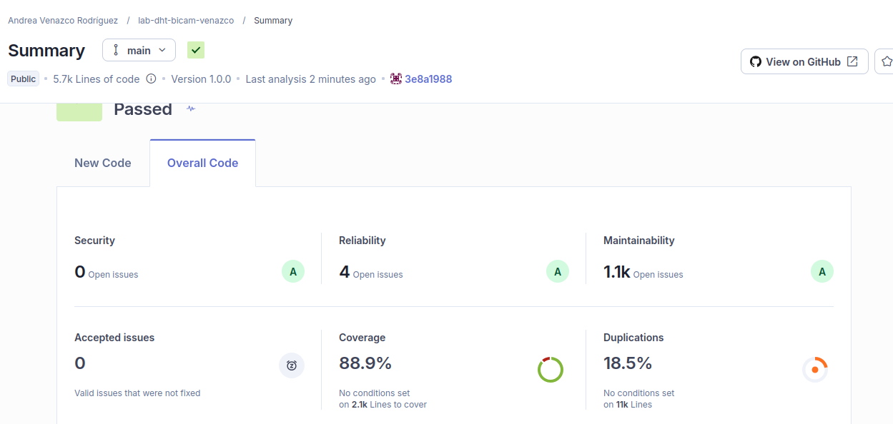
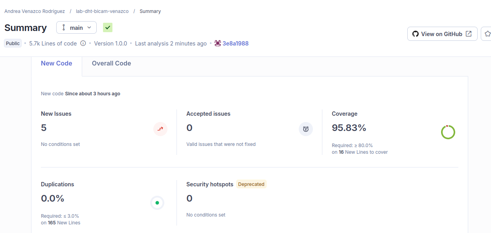

# Informe de SonarCloud — BiCIAM

**Proyecto:** [Andreaavr_lab-dht-bicam-venazco](https://sonarcloud.io/summary/overall?id=Andreaavr_lab-dht-bicam-venazco)  
**Repositorio:** https://github.com/Andreaavr/lab-dht-bicam-venazco  
**Análisis:** automático en cada push mediante GitHub Actions (`.github/workflows/build.yml`)  
**Fecha:** 23/11/2026

## Resultado

| Métrica | Resultado | Objetivo de la práctica |
|---|---|---|
| Quality Gate (Sonar way) | **Passed** ✅ | — |
| Security | **A** (0 issues) | — |
| Reliability (Bugs) | **A** | A o B ✅ |
| Maintainability (Code Smells) | **A** | A o B ✅ |
| Coverage (código global) | **88,9 %** | ≥ 80 % ✅ |
| Coverage (código nuevo) | **95,83 %** | ≥ 80 % ✅ |
| Duplicaciones (código nuevo) | **0,0 %** | — |
| Duplicaciones (código global) | 18,5 % | — (procede del código original) |

## Qué se sube a SonarCloud

- **Cobertura de JaCoCo** (`target/site/jacoco/jacoco.xml`) de las 130 pruebas JUnit 5.
- **Informes de la Fase 1** como issues externos: PMD (`target/pmd.xml`), Checkstyle
  (`target/checkstyle-result.xml`) y SpotBugs + FindSecBugs (`target/spotbugsXml.xml`).
- El análisis automático de SonarCloud está desactivado; el análisis lo hace el CI.

## Evolución

| Momento | Reliability | Maintainability | Coverage | Issues |
|---|---|---|---|---|
| Primer análisis | C (51 bugs) | D | 72,8 % | 15.346 |
| Final | **A** | **A** | **88,9 %** | ~1.100 |

## Correcciones realizadas

**Fiabilidad (C → A)**
- `Strategy.getProblem()` podía devolver `null` en 40 puntos de uso (javabugs:S2259): la
  estrategia pasa a crearse al cargar la clase y se añade `hasProblem()`.
- `MutationOperator.generateRandomState()` devolvía `null`; ahora genera estados aleatorios.
- SpotBugs: campos `volatile` en los hilos `InstanceGA/DE/EE`, getters para campos que solo se
  escribían y `Double.valueOf` en lugar de `new Double`.
- Bugs funcionales corregidos y cubiertos por pruebas (ver mensajes de commit): copia de
  estados que compartía la lista con el original, `clone()` que devolvía `this`, cruces de un
  punto y uniforme, lista tabú, criterios de aceptación al minimizar, etc.

**Mantenibilidad (D → A)**
- La nota la bajaban más de 14.000 avisos de **formato** de Checkstyle (google_checks) por el
  estilo Eclipse del código original (tabuladores, sangría, espaciado). Esas reglas de formato
  se suprimen en `config/checkstyle/checkstyle-suppressions.xml`; el resto de reglas siguen activas.

**Cobertura (72,8 % → 88,9 %)**
- 130 pruebas JUnit 5. Se excluyen del cálculo (igual que en la regla de JaCoCo) los
  generadores que en el código original no pueden ejecutarse de forma aislada:
  `MultiGenerator`, `ParticleSwarmOptimization`, `Particle`, `DistributionEstimationAlgorithm`
  y los hilos `Instance*`.

**Seguridad**
- 0 vulnerabilidades. Antes del análisis se eliminaron los hallazgos de OWASP Dependency-Check
  (dependencia `jxl` con `log4j 1.2.14`) y de FindSecBugs (`PREDICTABLE_RANDOM`,
  `printStackTrace`, reflexión sin control).

## Issues restantes

Los ~1.100 issues abiertos son de mantenibilidad de baja severidad, casi todos importados de
PMD, Checkstyle y SpotBugs sobre el código original (nombres de métodos en mayúscula como
`Evaluate` o `MinValue`, campos estáticos públicos que forman la API de configuración, etc.).
Corregirlos exigiría cambiar la API pública de la biblioteca y no afectan a las notas A.
